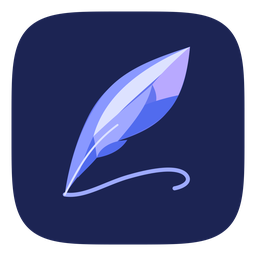

<div align="center">
  

# 墨笺 · Mojian

**原生、离线优先、支持可编辑手写内容的跨平台笔记应用**

[Windows](mojian/README.md) · [Android](android/README.md) · [macOS 开发分支](https://github.com/AlexbeatsZ/Mojian/tree/codex/macos-client/macos) · [iOS / iPadOS](ios/README.md) · [独立同步服务](sync-server/README.md) · [Releases](https://github.com/AlexbeatsZ/Mojian/releases)
</div>

## 项目介绍

墨笺（Mojian）围绕手写、课堂笔记、分层资料组织和原生笔输入构建。界面采用 **笔记本 → 可嵌套分区 → 页面** 的层次结构，并将笔迹、形状、文本、图片与附件保存为可继续编辑的内容，而不是只有截图的画布。

项目以本地文件为主，不需要在线账户即可使用；各客户端共享可交换的文档格式，但输入、窗口和系统交互使用对应平台的原生技术。墨笺是**独立应用**，不是 Notein、OneNote 的官方客户端；与现有笔记格式的互操作、迁移工具均有明确的来源和安全边界。

## 特色功能

- **手写和画布**：压感/倾角笔迹、钢笔与荧光笔、整笔擦除、套索/矩形选择、几何形状、撤销/重做、平移与缩放。手指、鼠标、触控笔按平台和工具分别处理。
- **可编辑的混合页面**：文字框、图片、表格、附件、PDF 页面批注、对象移动与尺寸调整；原始对象与资源尽可能保持可编辑和可导出。
- **层级管理**：多个笔记本、递归分区与页面列表；提供仅显示本层或包含下级的导航模式，以及针对条目的菜单操作。
- **阅读与导出**：页面背景、尺寸和横线设置，深浅色阅读；`.mjn` 笔记交换包及按平台支持的 PDF、图片、打印功能。
- **本地优先与可恢复保存**：普通文件夹格式，原子写入及损坏保护；同步、导入和删除均应保留恢复路径，而不是直接覆盖原始资料。
- **可选原生 HTTPS 文件同步**：Windows/Android 支持在明确创建的**独立副本**上启用版本同步，保留离线变更、操作回执和冲突。当前 v1 不提供 CRDT、多人实时协作或自动冲突消解。

不同端的功能尚未完全一致，以下状态不可相互推断。

## 平台与当前状态

| 平台 | 实现技术 | 已具备的主要能力与边界 |
| --- | --- | --- |
| **Windows** | C# / .NET / WPF / Windows Ink | 主力桌面客户端；混合对象编辑、笔输入、笔记结构、导出/打印与原生同步；源码版本 **0.7.8** |
| **Android** | Kotlin / Android 原生视图 | 平板/触笔交互、文档树、画布、插入与导出、本地文件夹和原生同步；源码版本 **0.7.8**（调试包使用独立包名） |
| **macOS** | Swift / AppKit + 共享 MojianCore | 原生桌面基线 **0.2.0**，已实现本机库、编辑、导入导出与打印；**位于独立的 `codex/macos-client` 分支**，现阶段既有外部库只读、尚无原生 HTTPS 同步 |
| **iOS / iPadOS** | Swift / UIKit + MojianCore | 原生笔输入、Apple Pencil 手势配置、页面编辑与导入导出；源码版本 **0.1.1**，仍需签名设备/实体 Pencil 验收 |

上述版本是已核对的源码/分支基线，**不表示四个平台拥有相同的 Release、安装情况或功能完成度**。macOS 的正式开发内容尚未合入默认 `master` 时，应从上表的分支链接查看；部分功能和设备手势仍需要实机验收。

## 数据文件与同步原则

Windows 和 Android 的原生库采用共享的文件布局（示意）：

```text
library.json
settings.json
notebooks/
  <notebook-id>/
    pages/<page-id>.json
    assets/<page-id>/...
```

macOS 使用兼容的 canonical v2 文件与本机设置；iOS 在应用的 `Documents/Workspace` 保存本地文档，支持通过文件导入/导出 `.mjn` 交换笔记。不要将某平台已实现的同步能力直接视为所有平台已具备。

Windows/Android 使用同步服务时：**先创建专用本地副本，不能直接在正在由 Syncthing 管理的文件夹里开启原生同步**。客户端不会随代码附带同步密钥或自动接管现有库。同步失败或出现并发修改时，需查看保留的恢复数据，不能通过清空检查点来消除冲突。详见 [协议与安全说明](sync-server/PROTOCOL.md) 与 [同步设计](docs/design/native-sync.md)。

## 下载与安装

请先检查 [GitHub Releases](https://github.com/AlexbeatsZ/Mojian/releases) **实际提供**的平台资产；不同平台发布节奏不同。

- **Windows**：使用发布的 `Mojian.exe`（自包含单文件版本时不需要另装 .NET Runtime）；首次使用按应用向导选择工作区。
- **Android**：安装相应的 APK；Debug 包与正式包的 application ID 不同。进入应用后通过 Android 系统文件选择器指定本地文件夹；不要卸载已有含私人笔记的包来做测试。
- **macOS**：当前独立开发分支可从源码生成 `Mojian.app`；现有构建为 ad-hoc 签名、未公证，不应描述为已完成的通用商店发行版。
- **iOS / iPadOS**：目前通过 Xcode 在模拟器或配置开发者签名的设备运行；模拟器包和未签名 device build **不是可直接安装的 IPA**。

## 开发与构建

### Windows

需要 .NET SDK、Windows 桌面开发环境；在仓库根目录运行：

```powershell
dotnet build mojian/Notein-win.slnx
dotnet test mojian/Notein-win.slnx
dotnet run --project mojian/src/Notein-win/Notein-win.csproj
dotnet publish mojian/src/Notein-win/Notein-win.csproj -c Release -r win-x64 --self-contained true -p:PublishSingleFile=true -p:IncludeNativeLibrariesForSelfExtract=true -o mojian/artifacts/release
```

### Android

需要 **JDK 17、Android SDK 36**；使用仓库 Gradle Wrapper：

```bash
cd android
./gradlew :app:testDebugUnitTest :app:assembleDebug :app:lintDebug
```

Windows 将 `./gradlew` 换为 `.\gradlew.bat`。输出位于 `android/app/build/outputs/apk/debug/`。正式包与签名、系统安装授权见 [Android 说明](android/README.md)；其早期实验性段落不应替代当前代码状态。

### macOS（独立开发分支）

需要 macOS 13+、完整 Xcode 与 Swift 工具链，先切换到 `codex/macos-client` 分支：

```bash
bash macos/tools/build.sh test
bash macos/tools/build.sh build
open macos/artifacts/current/Mojian.app
```

生成的本机 `.app` 与 ZIP 位于 `macos/artifacts/current/`；没有 Intel 构建或 Apple Developer ID 公证保证。详见 [macOS 说明](https://github.com/AlexbeatsZ/Mojian/blob/codex/macos-client/macos/README.md)。

### iOS / iPadOS

需要完整 Xcode；iOS 17+：

```bash
bash ios/tools/build.sh test
bash ios/tools/build.sh simulator
bash ios/tools/build.sh device
```

实体设备需在 Xcode 配置 Team/签名；[iOS 文档](ios/README.md)说明归档和 Pencil 功能的验收边界。

## 独立 HTTPS 同步服务（可选）

`sync-server/` 是无 UI 的 **Node.js 22+** 服务，可独立运行，不需要 `npm install`：

```bash
cd sync-server
MOJIAN_SYNC_DATA=/absolute/private/mojian-sync-data \
MOJIAN_SYNC_TOKEN=REPLACE_WITH_RANDOM_SECRET_AT_LEAST_32_BYTES_LONG \
node server.mjs
```

示例中的密钥必须换成私密的随机值，不能提交到 Git 或放进公开命令记录。默认只绑定 `127.0.0.1:18742`，公网访问应由**单独配置**的 HTTPS 反向代理暴露 `/mojian-sync/v1/` 并保留认证头。不要把原始笔记、服务器数据或现有服务任务当作可随意替换的构建产物。详细部署、备份、恢复及 Windows/Android 客户端接入见 [sync-server/README.md](sync-server/README.md)。

## 项目结构

| 路径 | 说明 |
| --- | --- |
| `mojian/` | Windows WPF 客户端与测试 |
| `android/` | Android 应用及 Gradle 构建 |
| `ios/` | UIKit 客户端与可移植 `MojianCore` |
| `macos/` | macOS AppKit 客户端（独立开发分支） |
| `shared/branding/` | 当前各平台羽毛图标的原始素材 |
| `sync-server/` | 原生 HTTPS 同步服务及协议 |
| `tools/data-migration/` | 历史数据迁移工具与测试 |
| `docs/design/` | 手写、存储、跨平台及同步的设计依据 |

**品牌图标**：本页使用仓库中现行 macOS 羽毛图标；Windows 使用[同系列透明图标](shared/branding/Mojian_Windows_256.png)。构建时应使用平台资源，避免继续引用早期测试版图形。

## 许可与来源

各组件的许可及第三方材料以 [THIRD_PARTY_NOTICES.md](THIRD_PARTY_NOTICES.md)、源码中的许可文件和对应依赖许可为准；与 Notein、OneNote 官方无关联。
